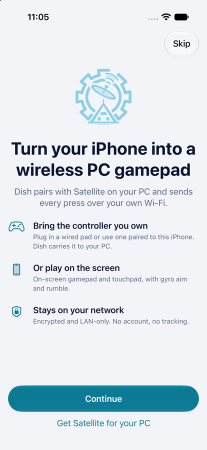

# Dish for iOS

Dish for iOS runs on your iPhone or iPad and sends the controller paired with it, or the phone's own screen, to your gaming PC as a wireless controller.

Dish is made of two parts. The Dish apps run on the device that holds your controller, or that is the controller: Dish for Android, Dish for iOS, Dish for macOS, Dish for Windows and Dish for Linux. Satellite is the small server on the PC you play on, and it makes each Dish controller look to your games like a controller plugged into that PC. You need one of each. Everything is free and open source, the website is [dish.tinkernorth.com](https://dish.tinkernorth.com), and I maintain all of it on my own.



## Download

Dish for iOS is built but not released yet.

There is no App Store listing, no TestFlight build and no file to download. The code on main is version 1.1.0, and [CHANGELOG.md](CHANGELOG.md) says what it holds. When I release it, it will appear on this repository's [releases page](https://github.com/TinkerNorth/dish-ios/releases); on GitHub, Watch, then Custom, then Releases tells you when that happens. Until then you can build it yourself and run it on your own iPhone or iPad, or in the simulator: the steps are under For developers.

Satellite and the other Dish apps are released:

### Satellite and the Dish apps

| App | Where to get it |
|---|---|
| Satellite (Windows, Linux) | [GitHub releases](https://github.com/TinkerNorth/satellite/releases/latest) |
| Dish for Android | [Google Play](https://play.google.com/store/apps/details?id=com.tinkernorth.dish), or the APK from [GitHub releases](https://github.com/TinkerNorth/dish-android/releases/latest) |
| Dish for iOS | Not yet released |
| Dish for macOS | [GitHub releases](https://github.com/TinkerNorth/dish-mac/releases/latest) |
| Dish for Windows | [GitHub releases](https://github.com/TinkerNorth/dish-windows/releases/latest) |
| Dish for Linux | [GitHub releases](https://github.com/TinkerNorth/dish-linux/releases/latest) |

## Getting started

1. Install Satellite on the PC you play on and start it. Its dashboard shows a 4-digit PIN under Device Pairing, with a new one every five minutes.
2. Build Dish onto your iPhone or iPad (see For developers), pair your controller with it in Settings, Bluetooth, or plug it in, and open Dish. The phone and the PC have to be on the same Wi-Fi. The first launch shows a short welcome; Continue starts Set up Dish, and Skip on any step lands on Controllers.
3. Pair them. Before Dish looks for the PC, it explains that iOS will ask for Local Network access; allow it. The PC shows up on Connections. Tap Pair beside it and type the PIN from the dashboard. Dish shows a code of its own at the same time under Accept on your PC; you can accept that request under Pairing Requests on the dashboard instead, if the two codes match. Dish remembers the PC, so you only pair once.
4. Play. Controllers lists your controller and the on-screen gamepad. Bind to sends one to the PC, and Emulate as on the controller's page picks the type the game sees: Xbox Wireless, DualShock 4, DualSense, DualSense Edge or Switch Pro. Open gamepad turns the phone itself into the controller.

## What it does

Dish reads each controller iOS gives it and sends it to the PC you bound it to, where Satellite turns it into a virtual controller. Input travels over UDP on your own network, encrypted with a key the two devices agree on when they pair. Up to four controllers can go to one PC.

Most controllers reach Dish through iOS's own game controller support, over Bluetooth or a cable: DualSense, DualShock 4, Xbox Wireless and Switch Pro controllers and the other pads iOS supports. What goes to the PC: buttons, sticks and triggers, motion and the touchpad from a PlayStation controller, and the battery (the lower of the controller's and the phone's). What comes back from the game: rumble, and on a DualSense the adaptive triggers, the light bar and the player lights.

| Controller | How Dish reads it | Notes |
|---|---|---|
| Pads iOS supports | iOS's game controller support | A pad iOS lists without the full gamepad layout shows as Not supported |
| Xbox Elite Series 2 | iOS's game controller support | Its four paddles reach a Satellite that speaks protocol 4, only while the pad is on its default profile; a virtual DualSense Edge has the back buttons to put them on |
| Steam Controller (2015 on its Bluetooth firmware, and 2026) | Bluetooth, once you turn on Settings › Steam Controllers › Read over Bluetooth | Back buttons, grips, gyro and trackpads; the 2026 one also rumbles |
| The phone's screen | Open gamepad, Open touchpad, Open mouse | Motion from the phone's sensors, rumble on its Taptic Engine |

None of these controller paths has been tried with a real controller yet. The tests run them against recorded pads and the simulator, and the network side against the real Satellite running on the same Mac.

iOS doesn't allow some things the Android and desktop apps do. An app gets no route to a controller's speaker, microphone or HD haptics. It can't read a pad iOS doesn't support itself, so the 8BitDo Ultimate 2 in X-input mode and Steam Controllers on a cable or their dongle don't work here (Dish for macOS reads them). iOS pauses an app you leave, so Dish keeps the screen on while you play and dims it instead of running in the background. Dish finds Satellite over mDNS only, because Satellite's older discovery beacon needs an Apple entitlement; if the PC doesn't show up, Add a PC by address on Connections takes its address. An iPhone with a Lightning port needs Apple's Lightning to USB Camera Adapter for a wired controller, and Dish says so on that iPhone.

Some things aren't ported from the other apps yet: a DualSense Edge's back buttons, an Elite's paddles to a Moonlight host, a Steam Controller's trackpads as the PC's mouse, renaming a controller, and holding a controller's place on the PC for a few seconds when its Bluetooth drops. [Tests/PARITY.md](Tests/PARITY.md) lists every difference and why.

Dish doesn't need Satellite to play on a Sunshine, Apollo or Wolf host. The Moonlight hosts row on Connections finds them on your network or takes an address, and Dish shows a PIN to type into the host. This path is tested against a stand-in host and not yet against a live one.

Diagnostics, under Settings › Setup & help, shows what each connection and controller is doing, and its Controller tests drive a controller's rumble, light bar, player lights and adaptive triggers from the phone alone, then ask whether each one worked. Dish carries the list of controllers the whole Dish family recognises and checks for a newer one. It follows the system's light or dark appearance, or the one you pick, and speaks English, Bosnian, German, Spanish, French and Brazilian Portuguese.

## Requirements

iOS 26 or later, on an iPhone or an iPad. There is no version for an older iOS. On an iPhone the app stands upright and turns on its side for the play screens; on an iPad it turns every way, and the tabs open into a sidebar.

Dish asks for Local Network access the first time it looks for a PC, and for Bluetooth only if you turn on Read over Bluetooth for a Steam Controller. It asks for nothing else. Its settings live in its own preferences and the keys from pairing in the Keychain.

Network: the phone and the PC on the same local network. Dish finds Satellite over mDNS, pairs and talks to it over HTTPS on TCP 9443, and streams on UDP 9876.

## Trust and privacy

Every release has a `SHA256SUMS` file signed with cosign by the release workflow. To check a download on Linux, put `SHA256SUMS` beside it and run:

```bash
sha256sum --ignore-missing -c SHA256SUMS
```

Dish for iOS has no release yet, so there is nothing to check today; once there is, `shasum -a 256 --ignore-missing -c SHA256SUMS` does the same on a Mac. [SECURITY.md](SECURITY.md) has the signature and build provenance checks, and how to report a vulnerability.

Nothing is signed yet, because nothing is released. The release workflow signs the app and uploads it to App Store Connect, for TestFlight and the App Store, once the App Store signing is set up for this repository, and I haven't done that yet. Without it a release carries only an unsigned IPA, named `dish-X.Y.Z-unsigned.ipa`, which an iPhone installs only after you re-sign it with your own certificate. A copy you build yourself is signed by your own Xcode.

Dish for iOS works on your own network and has no account, no analytics, no crash reporting and no ads. Three things can leave your network: a check for a newer controller database at dish.tinkernorth.com, which has its switch in Settings (Check for controller updates automatically); the prices of the three optional tips, which StoreKit asks the App Store for when you open Support Dish; and a support report, which only you send, from your own mail app. Controller input goes only to the PC you paired with. [PRIVACY.md](PRIVACY.md) says exactly what is stored and sent.

Dish for iOS is licensed under the GNU Lesser General Public License v3.0 or later ([LICENSE](LICENSE), with [COPYING.GPL3](COPYING.GPL3)). It links no third-party code; the components it ports from and the tools that build it, with their licences, are in [THIRD_PARTY.md](THIRD_PARTY.md).

## For developers

Dish for iOS is Swift 6 and SwiftUI: one SwiftPM package with no third-party dependencies, and a thin app project that XcodeGen generates from `project.yml`. CI builds with Xcode 26.6, warnings as errors. The scripts are the ones CI calls:

```bash
scripts/setup-hooks.sh        # once, with Xcode 26.6 installed: the pre-commit hook
scripts/test.sh iphone        # every test, on an iPhone simulator it creates and deletes
scripts/ci-local.sh           # every CI gate, in CI's order
```

To run the app in the simulator from a fresh clone, keep the folder named `dish-ios` (the generated project refers to it by that name):

```bash
git clone https://github.com/TinkerNorth/dish-ios.git && cd dish-ios
scripts/generate-project.sh --check    # fetches the pinned XcodeGen, checks the project
udid=$(scripts/ci-simulator.sh create "Dish iPhone" "iPhone 17 Pro")
xcodebuild build -project Dish.xcodeproj -scheme DishApp -derivedDataPath build \
  -destination "platform=iOS Simulator,id=$udid"
xcrun simctl install "$udid" build/Build/Products/Debug-iphonesimulator/Dish.app
xcrun simctl launch "$udid" com.tinkernorth.dish.ios
```

In Xcode, open `Dish.xcodeproj` and run the DishApp scheme; it also sells the tips from a local StoreKit file on the simulator. To put Dish on your own iPhone or iPad, choose your own team under Signing & Capabilities for the DishApp target, and a bundle identifier of your own if Xcode asks for one. The app needs no special entitlement.

Where things are written down:

- [docs/ARCHITECTURE.md](docs/ARCHITECTURE.md): the four modules, the dataflow rules, the threads and the input hot path.
- [docs/contract.md](docs/contract.md): where each part of the Satellite protocol and the Moonlight protocol lives in this tree.
- [docs/UI_CONTRACT.md](docs/UI_CONTRACT.md): the shell, the pages and the rules a view keeps.
- [docs/design/README.md](docs/design/README.md): the design handoff, its screens and copy rules, with the tokens in [DESIGN.md](DESIGN.md).
- [Tests/PARITY.md](Tests/PARITY.md): what this client has compared with the others, what iOS doesn't allow, and what is confirmed on hardware.
- [CHANGELOG.md](CHANGELOG.md): what changed in each version.

[CONTRIBUTING.md](CONTRIBUTING.md) covers setting up, where code goes, the interface, translations, the code style, the tests, branching, what CI runs, how a release is cut, and changing the hot path or the wire protocol. Please read it before opening a pull request.

## Getting help

If something doesn't work, open an issue at [github.com/TinkerNorth/dish-ios/issues](https://github.com/TinkerNorth/dish-ios/issues/new/choose). The most useful thing you can attach is the diagnostics file: in Settings, open Setup & help, then Diagnostics, press Report a problem, say what happened and pick the controller, and press Continue in Mail; Preview file shows you the file first. The file leaves out pairing keys, addresses, Wi-Fi names and the names of your PCs; read it before you attach it, it's plain JSON. Continue in Mail starts a mail to support@tinkernorth.com with the file attached, so if you'd rather write to me than open an issue, send that mail; nothing leaves your phone until you press Send.

Please also say which Dish for iOS version you run and how you installed it, your iPhone or iPad and its iOS version, which Satellite or Moonlight host and version you use, and which controller. If the problem is in Satellite rather than here, its own repository is the better place. For a security problem, don't open a public issue; [SECURITY.md](SECURITY.md) says how to report it privately.
